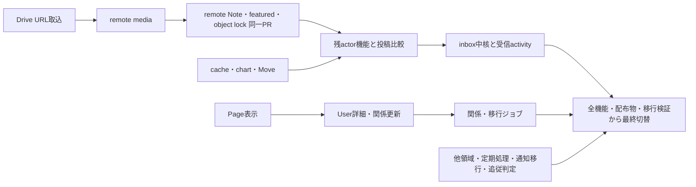

# 新バックエンドの有限バックログ

2026-11-14 棚卸し。[全体 #114](https://github.com/tiramiss-community/tiramiss/issues/114) の全工程を対象とする現在の入口。[GOALS](GOALS.md) が初期範囲の基準、[ROADMAP](ROADMAP.md) が既存成果と履歴、[backlog.json](backlog.json) が全作業・依存・完了条件の機械カタログである。

source baseline は PR #271 マージ後の [`110ef5d3af7bb7263337876c2f38be1652c0a23b`](https://github.com/tiramiss-community/tiramiss/commit/110ef5d3af7bb7263337876c2f38be1652c0a23b)。固定本家は [`8e07cf085adf7009583d234a208e30436f020e26`](https://github.com/misskey-dev/misskey/commit/8e07cf085adf7009583d234a208e30436f020e26)。fork固有機能は移植せず、独自の配送保証・容量契約・汎用再構築を初期必須に加えない。

#136で本家固定SHAを更新するときは、比較・Entity同期の基準が混在しないよう、本バックエンドの全作業セッションを止めて単独で行う。更新後は `upstream-sync.json` を正として各作業・対応表の基準を確認し、既存証跡との基準差を記録してから再開する。通常の機能開発はこの停止条件に含めない。更新前のSHAで比較した未マージPRは、新基準の差分が対象機能・生成物・検証へ与える影響を確認し、必要な比較と証跡を更新してからマージする。

## 親と作業単位

既存の領域親は範囲と完了条件を取りまとめる。子は有限の実装・比較・仕様判断を、対象・除外・done_when・検証で閉じられる単位にする。318単位は既存Issue再利用5件と新規起票対象313件、既存親51件（棚卸し時OPEN 47件）に対応する。これは作業カタログの件数であり、GitHub公開完了件数や完成率ではない。

| 現在地 | 意味 |
| --- | --- |
| 限定完了 | 記録した機能・証跡の範囲だけ完了。親全体の完成へ広げない |
| 部分実装 | 実装済み経路を継承し、未実装と未比較を具体単位へ残す |
| 未着手 | 実業務経路がまだない。Entity・adapterだけでは実装済みにしない |
| ready（69） | 有限成果物を**完了する**ための先行事実が基準時点で利用可能 |
| waiting（247） | 完了に必要な機能が未完了。独立した調査・fixture・手順準備は可能 |
| investigate（2） | 判断対象と成果物が限定された仕様確認。全領域を無期限調査にしない |
| deferred | #159/#161/#166 の追加保証。初期完成の依存から除外し、OPENを維持 |

S/M/L/XLは相対的なレビュー規模であり日数ではない。今回の内訳はS 45・M 200・L 73・XL 0。カレンダーや完了見込み率には換算しない。

## 全ストリームの入口

S1–S5は従来の領域分類を維持する。独立領域・運用も同じカタログで追跡し、担当セッションを新たに割り当てない。「最初」はready、なければ有限調査、なければ準備対象を示す。全件の順序は各単位のdepends_onで判断する。

| 領域 | 既存親 | 単位数 | ready | 最初に確認する作業 |
| --- | --- | ---: | ---: | --- |
| S1 連合 | [#176](https://github.com/tiramiss-community/tiramiss/issues/176) / [#195](https://github.com/tiramiss-community/tiramiss/issues/195) / [#215](https://github.com/tiramiss-community/tiramiss/issues/215) / [#216](https://github.com/tiramiss-community/tiramiss/issues/216) | 43 | 7 | [176-posting-proof · #272](https://github.com/tiramiss-community/tiramiss/issues/272) |
| S2 API・ユーザー | [#178](https://github.com/tiramiss-community/tiramiss/issues/178) / [#179](https://github.com/tiramiss-community/tiramiss/issues/179) / [#180](https://github.com/tiramiss-community/tiramiss/issues/180) / [#181](https://github.com/tiramiss-community/tiramiss/issues/181) / [#182](https://github.com/tiramiss-community/tiramiss/issues/182) / [#191](https://github.com/tiramiss-community/tiramiss/issues/191) | 62 | 15 | [178-note-gate · #283](https://github.com/tiramiss-community/tiramiss/issues/283) |
| S3 イベント・通知 | [#177](https://github.com/tiramiss-community/tiramiss/issues/177) / [#189](https://github.com/tiramiss-community/tiramiss/issues/189) / [#197](https://github.com/tiramiss-community/tiramiss/issues/197) / [#198](https://github.com/tiramiss-community/tiramiss/issues/198) / [#200](https://github.com/tiramiss-community/tiramiss/issues/200) / [#217](https://github.com/tiramiss-community/tiramiss/issues/217) | 50 | 7 | [177-notification-model · #298](https://github.com/tiramiss-community/tiramiss/issues/298) |
| S4 閲覧 | [#185](https://github.com/tiramiss-community/tiramiss/issues/185) / [#186](https://github.com/tiramiss-community/tiramiss/issues/186) / [#187](https://github.com/tiramiss-community/tiramiss/issues/187) | 26 | 6 | [185-pagination-notes · #305](https://github.com/tiramiss-community/tiramiss/issues/305) |
| S5 Drive・保守 | [#130](https://github.com/tiramiss-community/tiramiss/issues/130) / [#188](https://github.com/tiramiss-community/tiramiss/issues/188) / [#199](https://github.com/tiramiss-community/tiramiss/issues/199) | 37 | 4 | [188-folders · #278](https://github.com/tiramiss-community/tiramiss/issues/278) |
| 投稿周辺・交流 | [#183](https://github.com/tiramiss-community/tiramiss/issues/183) / [#184](https://github.com/tiramiss-community/tiramiss/issues/184) | 14 | 6 | [183-drafts · #438](https://github.com/tiramiss-community/tiramiss/issues/438) |
| chat・ゲーム・公開情報・管理・HTML | [#190](https://github.com/tiramiss-community/tiramiss/issues/190) / [#192](https://github.com/tiramiss-community/tiramiss/issues/192) / [#193](https://github.com/tiramiss-community/tiramiss/issues/193) / [#194](https://github.com/tiramiss-community/tiramiss/issues/194) / [#196](https://github.com/tiramiss-community/tiramiss/issues/196) | 62 | 13 | [193-public-meta · #399](https://github.com/tiramiss-community/tiramiss/issues/399) |
| 派生保守・本家追従・配布・切替 | [#132](https://github.com/tiramiss-community/tiramiss/issues/132) / [#133](https://github.com/tiramiss-community/tiramiss/issues/133) / [#135](https://github.com/tiramiss-community/tiramiss/issues/135) / [#136](https://github.com/tiramiss-community/tiramiss/issues/136) / [#138](https://github.com/tiramiss-community/tiramiss/issues/138) / [#139](https://github.com/tiramiss-community/tiramiss/issues/139) | 24 | 11 | [132-data-authority · #132](https://github.com/tiramiss-community/tiramiss/issues/132) |

## 先行条件の前線と完了までの経路

1. **現在の成果を利用する前線**: 投稿本体の証跡照合、API note gate、Page読取、関係読取、通知型、stream registry、Driveのfolder/file参照・画像処理、独立公開API・CLI/配布手順を各ready単位で進める。共通基盤という一括作業で業務コードを隠さない。
2. **利用者付きの接続**: Page表示→User詳細→follow/request/block、Drive upload/delete→URL取込→remote media、通知→Web Push、registry→各領域channel、chart保存方式→12系列・producer・定期処理へ進める。必要な境界だけを先行させる。
3. **公開投稿から受信へ**: remote media→remote Note＋remote featured＋object lockを同一PRで公開actorから接続する。cache・Move・chart等の残actor機能も揃えて投稿比較を完了し、その後inbox中核・各受信activityへ進む。公開actorの完成をHTTP inbox全体待ちにはしない。
4. **全体切替**: 各機能の比較、残7業務handler・system 9 scheduler、通知移行、配布物、追従台帳の未対応なし判定、完全停止のbackup/復元・リハーサルを揃える。準備を先行できても最終切替の受入条件を省略しない。

図は主要経路の抜粋。全749葉依存はJSONと各作業Issueに残す。GitHub Relationships用の544辺は推移的に縮約した表現であり、要件削除ではない。親子関係は所属を示す。最終 #139 は元の契約から対象版の全機能・配布物と #135 の未対応なし判定を要するため、GitHubの依存登録50件上限に合わせて既存領域親をgateとする例外がある。通常の作業を親全体待ちに戻す規則ではない。統合グラフの機械検査は360 node・循環0であり、実機能の同等性を証明しない。

## 同一PRで届ける12組

利用者のないprimitiveを先行完成させず、次の組は接続まで同一PRで完了させる。全318単位をこの条件で束ねると305の原子的納品単位になるが、将来の総PR数の予測ではない。

- [178-multipart · #387](https://github.com/tiramiss-community/tiramiss/issues/387) ＋ [188-upload · #284](https://github.com/tiramiss-community/tiramiss/issues/284)
- [216-download · #376](https://github.com/tiramiss-community/tiramiss/issues/376) ＋ [188-url-ingest · #287](https://github.com/tiramiss-community/tiramiss/issues/287)
- [216-preview-agent · #377](https://github.com/tiramiss-community/tiramiss/issues/377) ＋ [196-preview · #560](https://github.com/tiramiss-community/tiramiss/issues/560)
- [216-s3-agent · #378](https://github.com/tiramiss-community/tiramiss/issues/378) ＋ [188-s3 · #285](https://github.com/tiramiss-community/tiramiss/issues/285)
- [216-webpush-agent · #379](https://github.com/tiramiss-community/tiramiss/issues/379) ＋ [177-push-delivery · #374](https://github.com/tiramiss-community/tiramiss/issues/374)
- [195-remote-notes · #329](https://github.com/tiramiss-community/tiramiss/issues/329) ＋ [195-remote-featured · #289](https://github.com/tiramiss-community/tiramiss/issues/289) ＋ [215-object-lock · #328](https://github.com/tiramiss-community/tiramiss/issues/328)
- [182-mutes · #417](https://github.com/tiramiss-community/tiramiss/issues/417) ＋ [217-relation-cache · #300](https://github.com/tiramiss-community/tiramiss/issues/300)
- [193-decoration-read · #368](https://github.com/tiramiss-community/tiramiss/issues/368) ＋ [217-decoration-cache · #367](https://github.com/tiramiss-community/tiramiss/issues/367)
- [182-follow-local · #301](https://github.com/tiramiss-community/tiramiss/issues/301) ＋ [200-social-charts · #307](https://github.com/tiramiss-community/tiramiss/issues/307)
- [193-announcement-archive · #449](https://github.com/tiramiss-community/tiramiss/issues/449) ＋ [199-archive · #450](https://github.com/tiramiss-community/tiramiss/issues/450)
- [194-admin-channel · #355](https://github.com/tiramiss-community/tiramiss/issues/355) ＋ [194-report-notify · #356](https://github.com/tiramiss-community/tiramiss/issues/356)
- [177-chat-push · #435](https://github.com/tiramiss-community/tiramiss/issues/435) ＋ [190-message-alert · #527](https://github.com/tiramiss-community/tiramiss/issues/527)

## 有限の判断と保護する完了条件

chartの未決事項は [200-chart-storage-contract · #273](https://github.com/tiramiss-community/tiramiss/issues/273) の12系列hour/day生成schema・既存履歴・同期境界に限定する。共有SQL補助・型宣言の対応は [178-shared-contract-audit · #391](https://github.com/tiramiss-community/tiramiss/issues/391) で未分類宣言を残さず閉じる。

[132-data-authority · #132](https://github.com/tiramiss-community/tiramiss/issues/132) → [133-selected-rebuild · #133](https://github.com/tiramiss-community/tiramiss/issues/133) は投稿派生値・検索・TL・chartの正本と通常更新/保持を比較し、既存担当で充足しない最初の具体対象を確定して実装する。本家のresyncCharts（Drive・Notes・Users）と追加保守を区別し、履歴再現・Redis全損復旧など新保証や汎用再構築を追加しない。

- #115は初期Roleの限定範囲完了だが管理上OPENを維持し、残Role APIは #181 で追跡する。
- #122は通常3 handlerの限定成果を継承する。残る通常業務・定期ジョブが未完了であり、queue名の登録を完成としない。
- #124/#163/#164/#165はCLOSEDの限定成果をそのまま保持し、今回の再編で再開しない。
- #176/#127は残actor機能が実装・比較されるまでOPEN。担当割当やRefsだけでは閉じず、`notes/create:partial` / `postingComplete:false`を維持する。
- #159/#161/#166は保留のまま初期範囲から除外する。

## 進捗の更新と証明範囲

このカタログは2026-11-14の作業選定用snapshot。公開後の進捗は各IssueとRelationshipsを確認する。公開番号の結合と、Issue本文・親子・依存の公開検証は別の確認である。

実装するagentはPRで対象の作業子を閉じ、自分のinventory行と親の残作業・証跡を更新する。親は固有の完了条件を確認して閉じる。Refs、担当割当、子一覧への追加、基盤の完成から親を自動closeしない。既存の閉鎖済み範囲と保留を新しい切替blockerにしない。

2,119契約・1,432監査行の割当にはmissing/unknownがないが、source上の対応事実であり、新しいruntime parityや全3,551行の独立実行を意味しない。S1の一部ID配列は先行対応表から継承して機械照合したもの。既存の限定実測・source-method/doubles・未検証を分け、元inventoryを昇格させない。最終9指摘と2 command依存修正は適用済みで、patch一致・依存検査で追跡した。元レビューのMUST_FIXは修正前の履歴であり、全体の形式的APPROVEDや新テスト成功を主張しない。
